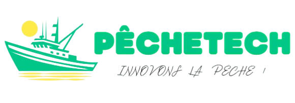

<div align="center">



# PecheTech SuperApp

**L'application mobile et web des pêcheurs artisanaux du Sénégal.**
Météo marine, zones de pêche, avantages et partage des revenus, subventions carburant et communauté, réunis dans une seule application.


<br />

<p align="center">
  &nbsp;
  &nbsp;
  &nbsp;
  
</p>

</div>

---

## Sommaire

- [À propos](#à-propos)
- [Découvrir l'application](#découvrir-lapplication)
- [État d'avancement](#état-davancement)
- [Fonctionnalités](#fonctionnalités)
- [Écosystème PecheTech](#écosystème-pechetech)
- [Stack technique](#stack-technique)
- [Structure du projet](#structure-du-projet)
- [Démarrage rapide](#démarrage-rapide)
- [Tests, CI et déploiement](#tests-ci-et-déploiement)
- [Feuille de route](#feuille-de-route)
- [Contribuer](#contribuer)

## À propos

PecheTech SuperApp est l'application destinée aux utilisateurs finaux de la plateforme PecheTech. Elle regroupe, dans une expérience unique, les services dont un pêcheur a besoin au quotidien : conditions en mer, zones de pêche, suivi des revenus et des dépenses, accès aux aides carburant, et échanges avec la communauté.

L'application est développée avec **Flutter** (interface en français) et s'appuie sur **Firebase** (authentification et base de données). Elle est destinée à consommer à terme les microservices du reste de l'écosystème PecheTech (voir [Écosystème](#écosystème-pechetech)).

## Découvrir l'application

PecheTech guide le pêcheur de la connexion jusqu'à la vente de sa pêche. Voici le parcours, illustré par les maquettes de design du dossier [`maquette/pecheTech/`](maquette/pecheTech) (une archive `pecheTech.zip` est aussi disponible).

> **Note :** ce sont des **maquettes de conception**. Elles montrent l'interface cible ; certaines fonctions (assistant vocal, tendances et conseils par IA, badges) ne sont pas encore développées. Le tableau [État d'avancement](#état-davancement) indique ce qui fonctionne aujourd'hui.

<table>
  <tr>
    <td valign="top" align="center">&nbsp;</td>
    <td valign="top">

#### 1. Se connecter en toute simplicité

Un écran d'accueil sobre : connexion par **téléphone et mot de passe**, ou en un geste avec **Google**. Les nouveaux utilisateurs créent leur compte depuis l'écran d'inscription, et un lien « Mot de passe oublié » est toujours à portée.

</td>
  </tr>
</table>

<table>
  <tr>
    <td valign="top" align="center">&nbsp;</td>
    <td valign="top">

#### 2. Un tableau de bord pour préparer la marée

Dès l'ouverture, le pêcheur voit l'essentiel : la **météo marine** de son port (température, vent, houle), son **solde de partage** en FCFA, ses **activités récentes** (captures, alertes, paiements) et les **zones de pêche actives** à proximité. Un bouton micro, en bas à droite, prépare l'usage **vocal** pour les mains occupées.

</td>
  </tr>
</table>

<table>
  <tr>
    <td valign="top" align="center">&nbsp;&nbsp;</td>
    <td valign="top">

#### 3. Des alertes météo à trois niveaux

La sécurité d'abord. Le tableau de bord change de ton selon la mer : **conditions favorables**, **alerte modérée**, ou **alerte critique à priorité haute** (par exemple des vagues de plus de 3 mètres, avec une sortie en mer formellement déconseillée).

</td>
  </tr>
</table>

<table>
  <tr>
    <td valign="top" align="center">&nbsp;</td>
    <td valign="top">

#### 4. Pêcher au bon endroit, avec le bon carburant

La **carte de durabilité** affiche les zones de pêche autorisées et les aires protégées, avec une recherche et des filtres. L'écran **Ma Journée** présente le **bon de carburant** à QR code (valeur, station, expiration), une **zone recommandée** avec sa distance et la probabilité de trouver du thon, puis l'enregistrement de la capture (espèce et poids).

</td>
  </tr>
</table>

<table>
  <tr>
    <td valign="top" align="center">&nbsp;</td>
    <td valign="top">

#### 5. Vendre au meilleur prix, entre acteurs de la filière

Le **marché journalier** donne les prix en direct par espèce (Lotte, Capitaine, Dorade, Sardinelle), leurs variations, le volume échangé et une tendance. La **communauté** met en relation mareyeurs, transformatrices, transporteurs frigorifiques et coopératives, avec des profils vérifiés et un bouton pour les contacter.

</td>
  </tr>
</table>

<table>
  <tr>
    <td valign="top" align="center">&nbsp;&nbsp;</td>
    <td valign="top">

#### 6. Un compte qui reflète son activité

Le **profil** résume les statistiques clés du pêcheur (captures totales, score de durabilité, jours en mer) et ses badges. Les **notifications** regroupent alertes météo, variations de prix, paiements reçus et mentions de la communauté. Les **paramètres** couvrent la langue (français et wolof), la confidentialité et l'aide.

</td>
  </tr>
</table>

### États de l'interface

L'application prévoit aussi les cas où tout ne se passe pas comme prévu : chargement et erreur réseau.

<table>
  <tr>
    <td align="center" valign="top"><br /><sub>Chargement</sub></td>
    <td align="center" valign="top"><br /><sub>Erreur</sub></td>
    <td align="center" valign="top"><br /><sub>Barre de navigation</sub></td>
  </tr>
</table>

## État d'avancement

Ce tableau indique honnêtement ce qui est opérationnel et ce qui reste à faire.

| Domaine | État | Détails |
|---|---|---|
| Authentification | ✅ Fonctionnelle | Email / mot de passe, Google, téléphone (SMS), mot de passe oublié, via Firebase Auth |
| Profil et paramètres | ✅ Fonctionnelle | Profil stocké dans Firestore, modification du profil avec photo, écran de paramètres |
| Notifications | ✅ Fonctionnelle | Notifications stockées dans Firestore (lecture, suppression) |
| Météo marine | ✅ Fonctionnelle | Vent, température, houle via l'API publique Open-Meteo |
| Zones de pêche | ✅ Fonctionnelle | Zones du jour lues dans Firestore, avec repli si la base est vide ou injoignable |
| Avantages et finances | 🟡 En cours | Tableau de bord des avantages, partage des revenus, saisie de dépenses par lecture de reçu (OCR) |
| Carburant | 🟡 En cours | Parcours « Ma Journée » (bon carburant, zone recommandée, enregistrement de capture) |
| Journal, carte, communauté | 🟡 Interface | Écrans présents, sans source de données branchée pour l'instant |
| Connexion aux microservices | ⏳ À venir | L'URL de l'API Gateway est configurable (`API_BASE_URL`) mais pas encore utilisée |
| Synchronisation hors ligne | ⏳ À venir | `lib/local_storage/sync_manager.dart` est vide |
| Documentation d'architecture | ⏳ À venir | `docs/architecture.md` est vide |
| Tests | 🟡 Partiels | Tests unitaires des services météo, prédiction de zones et finances |

## Fonctionnalités

- **Connexion et inscription** : email et mot de passe, compte Google ou numéro de téléphone, avec récupération de mot de passe.
- **Tableau de bord** : météo marine en direct, solde de partage, activités récentes et zones de pêche actives, avec états de chargement, d'erreur et d'alerte météo.
- **Carte de durabilité** : zones de pêche autorisées et aires protégées.
- **Ma Journée (carburant)** : bon de carburant à QR code, zone recommandée par l'application, enregistrement des captures (espèce et poids).
- **Avantages et partage des revenus** : suivi des revenus, répartition, saisie de dépenses depuis une photo de reçu.
- **Suivi des prix du marché** : consultation des prix par espèce.
- **Communauté** : mise en relation entre pêcheurs.
- **Notifications, profil et paramètres**.

## Écosystème PecheTech

La SuperApp est le point d'entrée utilisateur d'une architecture en services, hébergée dans l'organisation [Mg4TechPechetech](https://github.com/Mg4TechPechetech) :

| Dépôt | Rôle (d'après son nom) |
|---|---|
| [pechetech-api-gateway](https://github.com/Mg4TechPechetech/pechetech-api-gateway) | Point d'entrée unique vers les services |
| [pechetech-benefit-service](https://github.com/Mg4TechPechetech/pechetech-benefit-service) | Aides et avantages |
| [pechetech-fuel-service](https://github.com/Mg4TechPechetech/pechetech-fuel-service) | Subventions carburant |
| [pechetech-predictive-weather-service](https://github.com/Mg4TechPechetech/pechetech-predictive-weather-service) | Prévisions météo marines |
| [pechetech-finance-ocr-service](https://github.com/Mg4TechPechetech/pechetech-finance-ocr-service) | Lecture automatique de documents financiers |
| [pechetech-blockchain-service](https://github.com/Mg4TechPechetech/pechetech-blockchain-service) | Traçabilité et enregistrement vérifiable |
| [pechetech-infrastructure](https://github.com/Mg4TechPechetech/pechetech-infrastructure) | Infrastructure et déploiement |

## Stack technique

- **Framework :** Flutter (Material Design), Dart `>=3.2.0 <4.0.0`
- **Authentification :** `firebase_core`, `firebase_auth`, `google_sign_in`
- **Données :** `cloud_firestore`, `firebase_storage`
- **Réseau :** `http` (Open-Meteo, OCR)
- **Interface :** `flutter_svg`, `google_fonts`, `image_picker`, `image_cropper`, `intl`
- **Qualité du code :** `flutter_lints`
- **Plateformes dans le dépôt :** Android (`com.pechetech.superapp`), Web et Linux

## Structure du projet

```text
.
├── lib/
│   ├── main.dart                  # Point d'entrée, initialisation Firebase
│   ├── firebase_options.dart      # Configuration Firebase générée
│   ├── core/                      # Thème, constantes d'API, widgets communs
│   ├── features/                  # Modules par fonctionnalité (data/ et presentation/)
│   │   ├── auth/                  # Connexion, inscription, mot de passe oublié
│   │   ├── dashboard/             # Tableau de bord
│   │   ├── weather/               # Météo marine (Open-Meteo)
│   │   ├── map/                   # Carte et zones de pêche
│   │   ├── benefits/              # Avantages, partage des revenus, OCR de reçus
│   │   ├── fuel_subsidies/        # Parcours carburant
│   │   ├── journal/               # Journal et prix du marché
│   │   ├── community/             # Communauté
│   │   ├── notifications/         # Notifications
│   │   └── profile/               # Profil, modification, paramètres
│   ├── shared/widgets/            # Composants partagés (barre de navigation)
│   └── local_storage/             # Synchronisation hors ligne (à implémenter)
├── assets/images/                 # Logos et icônes
├── maquette/pecheTech/            # Maquettes de design
├── test/features/                 # Tests unitaires par fonctionnalité
├── docs/                          # Documentation d'architecture
├── android/  web/  linux/         # Cibles de plateforme
└── .github/workflows/             # CI / CD
```

## Démarrage rapide

### Prérequis

- [Flutter SDK](https://docs.flutter.dev/get-started/install) (canal stable ; la CI utilise la version 3.41.9)
- Android Studio avec un émulateur ou un appareil Android, ou Google Chrome pour la version web
- Un projet Firebase si vous souhaitez utiliser votre propre configuration

### Installation

```bash
git clone https://github.com/Mg4TechPechetech/pechetech-superapp.git
cd pechetech-superapp
git checkout develop
flutter pub get
```

### Lancer l'application

```bash
flutter devices                 # liste les appareils disponibles
flutter run                     # appareil ou émulateur connecté
flutter run -d chrome           # version web
flutter run -d linux            # version bureau Linux
```

Pour cibler une API Gateway précise (par défaut `http://localhost:8080/api/v1`) :

```bash
flutter run --dart-define=API_BASE_URL=https://votre-passerelle.example/api/v1
```

### Configurer Firebase

Le fichier `lib/firebase_options.dart` est déjà présent. Pour pointer vers **votre propre** projet Firebase :

1. Installez la CLI : `dart pub global activate flutterfire_cli`
2. Lancez `flutterfire configure` à la racine du projet.
3. Dans la console Firebase, activez **Authentication** (Email/Mot de passe, Google, Téléphone) et **Cloud Firestore**.

## Tests, CI et déploiement

```bash
flutter analyze   # analyse statique (flutter_lints)
flutter test      # tests unitaires (météo, prédiction de zones, finances)
```

- **CI** (`.github/workflows/flutter-ci.yml`) : analyse et tests à chaque push et Pull Request sur `develop`, `main` et `staging`.
- **CD** (`.github/workflows/flutter-cd.yml`) : build web de production et publication sur la branche `gh-pages` (GitHub Pages, chemin de base `/pechetech-superapp/`).

## Feuille de route

- [ ] Connecter l'application à l'API Gateway et aux microservices
- [ ] Brancher des données réelles sur le journal, la carte et la communauté
- [ ] Implémenter la synchronisation hors ligne (connectivité limitée en mer)
- [ ] Externaliser les clés d'API via `--dart-define` plutôt que dans le code
- [ ] Ajouter la cible iOS
- [ ] Étendre la couverture de tests (écrans et authentification)
- [ ] Rédiger `docs/architecture.md`
- [ ] Ajouter un fichier `LICENSE`

## Contribuer

1. Créez une branche à partir de `develop` (`feature/ma-fonctionnalite`).
2. Vérifiez que `flutter analyze` et `flutter test` passent.
3. Ouvrez une Pull Request vers `develop`.

## Licence

Aucune licence n'est définie pour le moment. Tous droits réservés tant qu'un fichier `LICENSE` n'a pas été ajouté.
